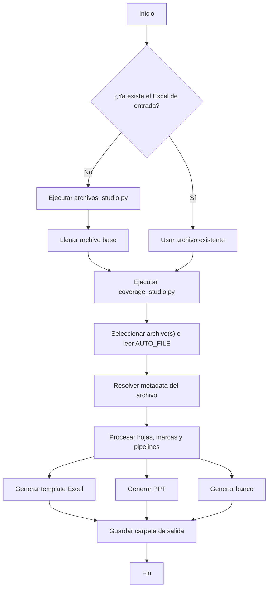

# CoverageLab


Automatiza el flujo de coberturas desde un archivo Excel de entrada hasta tres entregables finales:

- un `Template_...xlsx` de trabajo
- una presentación `...pptx`
- un `Banco_...xlsx` consolidado

El proyecto está centrado en `coverage_studio.py`, que procesa metadata del archivo, interpreta hojas por marca o pipeline, genera slides y construye el banco final.

La pantalla local integra ahora **Archivos de entrada → Coberturas → Investigación 5W1H**.
Puedes crear y llenar los libros, explorar resultados y generar informes desde
la misma página. Los scripts de consola siguen disponibles.

## Contenido

- [Qué hace](#qué-hace)
- [Estructura del proyecto](#estructura-del-proyecto)
- [Requisitos](#requisitos)
- [Instalación](#instalación)
- [Uso rápido](#uso-rápido)
- [Estudio integral en la web](#estudio-integral-en-la-web)
- [Formato del archivo de entrada](#formato-del-archivo-de-entrada)
- [Convenciones por hoja](#convenciones-por-hoja)
- [Casos especiales soportados](#casos-especiales-soportados)
- [Modo automático](#modo-automático)
- [Salidas generadas](#salidas-generadas)
- [Flujo general](#flujo-general)
- [Troubleshooting](#troubleshooting)
- [Notas operativas](#notas-operativas)

## Qué hace

`coverage_studio.py`:

- lee un `.xlsx` de entrada con estructura por hojas
- detecta país, categoría y fabricante desde el nombre del archivo
- arma un template Excel con cálculos y gráficos nativos
- genera el PPT final usando `Modelo_PPT.pptx`
- construye un banco de coberturas con metadata por marca, pipeline y contexto del archivo

Además, hoy ya incorpora lógica específica para:

- resolución de metadata `MULT` por hoja en casos como `55_MULT_Unilever.xlsx` y `12_MULT_Colgate.xlsx`
- llenado de `Subcategoria` en el banco a partir del texto entre paréntesis en el nombre de la hoja
- autoajuste de columnas en banco y template Excel
- mejor distribución de anchos y encabezados del `summary` dentro del PPT

## Estructura del proyecto

- `coverage_studio.py`: motor principal de generación
- `archivos_studio.py`: asistente para crear archivos base de captura
- `scorecards_studio.py`: exportador de scorecards
- `pipeline_explorer.py`: pantalla local para revisar y elegir pipelines antes de generar
- `studio_inputs.py`: creación, importación y edición de entradas con guardado atómico
- `studio_workflow.py`: continuidad de las etapas, invalidación y trabajos 5W1H
- `studio_5w1h.py`: investigación y exportación usando el motor original de 5W1H
- `studio_5w1h_vendor/`: motor y modelos locales necesarios; sin depender del programa externo
- `explorer_web/`: interfaz del explorador (HTML, CSS y JavaScript, sin dependencias web)
- `Abrir_Explorador.cmd`: acceso para iniciar el explorador en Windows
- `Modelo_PPT.pptx`: plantilla obligatoria para construir la presentación
- `requirements.txt`: dependencias Python

## Requisitos

- Python 3.11 o superior (requerido por pandas 3.0.1)
- `pip` actualizado
- dependencias de `requirements.txt`
- `Modelo_PPT.pptx` presente en la raíz del proyecto

## Instalación

Instalación recomendada:

```bash
pip install -r requirements.txt
```

Si prefieres instalación manual:

```bash
pip install pandas numpy matplotlib openpyxl tqdm colorama rich dataframe_image scipy python-pptx pillow
```

## Uso rápido

### Explorar pipelines en el navegador antes de generar

En Windows puedes hacer doble clic en `Abrir_Explorador.cmd`. También puedes ejecutar:

```bash
python pipeline_explorer.py
```

O iniciar la pantalla desde el programa principal:

```bash
python coverage_studio.py --explorar
```

Abre automáticamente `http://127.0.0.1:8765/`. Mantén abierta la terminal mientras
usas el explorador; `Ctrl+C` cierra el servidor. Si el puerto está ocupado:

```bash
python pipeline_explorer.py --port 8766
```

1. Selecciona un Excel y el template de salida; pulsa **Cargar y explorar**.
   El selector traduce los códigos a país, categoría y fabricante. **Ver archivos
   y sus detalles** abre tarjetas con búsqueda y filtros por país/categoría.
   La ficha conserva el nombre original, códigos, cesta, tamaño y fecha de modificación.
   En archivos MULT la categoría se resuelve por hoja al cargar.
2. Selecciona una hoja y revisa P0–P6. Puedes comparar dos pipelines, mostrar
   Sell-in original, cambiar entre volumen mensual, volumen MAT y cobertura MAT,
   y ver toda la historia o los últimos 12/24 meses.
   Activa **Etiquetas de datos** para mostrar el último valor o todos los valores;
   las historias extensas se pueden desplazar horizontalmente al etiquetarlas.
   **Detalle visual** activa o desactiva cuadrícula, puntos y relleno de tendencia.
   Los colores de Sell-in/Worldpanel y cobertura/penetración son los mismos del PPT.
   En **Cobertura MAT** puedes mostrar la penetración mensual y la cobertura
   original P0, además de otro pipeline. La penetración conserva el mes original
   y no cambia al desplazar Sell-in. El resumen compara cobertura, correlación
   MAT y estabilidad; evalúalos junto con el gap para decidir el ajuste.
   Estas preferencias visuales se recuerdan en el navegador y afectan la vista local.
   El gráfico también muestra penetración, compradores, compra media, compra por
   ocasión, frecuencia y evolución de variaciones interanuales MAT.
3. Consulta correlación MAT, cobertura, variaciones, gap y estabilidad. AUTO
   Balanceado y AUTO Correlación se muestran como referencias; P0 se permite
   como elección manual, aunque la recomendación automática compara P1–P6.
4. Elige un pipeline por hoja y desmarca las hojas que quieras excluir.
   La elección manual tiene prioridad sobre el prefijo de la hoja y AUTO.
5. **Guardar selección** permite recuperar las elecciones para la misma versión
   del Excel. **Revisar y generar** muestra la selección antes de iniciar.
6. Abre los entregables o su carpeta desde la pantalla.

## Estudio integral en la web

Abre `Abrir_Explorador.cmd` o ejecuta `python pipeline_explorer.py --no-browser`.
Usa las tres opciones de la barra superior sin salir de `http://127.0.0.1:8765/`.

### 1. Archivos de entrada

La ficha muestra **país, categoría y fabricante** del archivo seleccionado como
datos informativos. Estos campos se eligen al crear una entrada; no cambian la
identidad de un libro existente. El selector **Archivo** abre los libros disponibles.
**Nueva entrada** parte del contexto del libro actual.

Elige un método de captura: **Excel de escritorio** muestra la guía y sus botones;
**Editar en la web** muestra la tabla y las acciones de edición. Solo se presenta
el método elegido. En Windows con Excel disponible se propone el modo de escritorio;
al recuperar un borrador se abre la edición web para poder corregirlo.

**Nueva entrada** usa los países, categorías y nombres de `archivos_studio.py`.
Indica fabricante y marcas; cobertura crea una hoja `P0_<marca>` por marca,
con el orden de ocho columnas original. La unidad queda en el encabezado y se
conserva al añadir hojas. **Importar Excel** permite cargar un `.xlsx` de hasta
10 MiB sin sobrescribir archivos existentes.

En Windows con Excel instalado, **Abrir en Excel** utiliza la interfaz real de
Excel de escritorio. Pega y guarda en Excel; después pulsa **Actualizar desde
Excel** para leer esa versión, validar los períodos e invalidar los análisis
anteriores. Los libros externos de 5W1H se copian íntegramente a `inputs/5w1h/`
antes de abrirse, conservando el original. Guarda o descarta los borradores del
editor web antes de abrir o actualizar. La aplicación conserva también la
captura web para quien prefiera trabajar dentro de la página.

Las fechas de las columnas de calendario se muestran uniformemente como
`ene 2024`, incluso cuando el origen mezcla `Jan-24`, fechas Excel y seriales.
El valor original permanece en la barra de la celda y al editar/copiar; la
presentación no escribe en el libro ni modifica cálculos o fechas guardadas.

Selecciona una celda y pega el rango de Excel, o usa **Pegar bloque**. El editor
admite bloques de varias filas/columnas, celdas vacías, doble clic/F2, Enter/Tab,
flechas, selección con Mayús, copia de rangos y deshacer. Puedes cambiar de hoja
conservando el borrador y guardar los cambios de todas las hojas juntos.
**Nueva entrada**, importar y abrir otro archivo conservan primero el borrador en
`inputs/drafts/`, aunque contenga fechas o números inválidos. Al volver al archivo,
se recuperan las celdas de todas sus hojas. Este borrador no modifica el Excel ni
se utiliza como datos del análisis. Si cambió el archivo original, se conserva el
borrador anterior para consulta y no se aplica automáticamente. Un guardado válido
retira el borrador; **Descartar cambios** lo elimina explícitamente.
Las ventanas muestran 60 filas y hasta 32 columnas; usa las coordenadas y los
controles de rango para consultar toda la hoja. Los límites son 20 000 filas,
256 columnas, 100 hojas y 50 000 celdas por operación de guardado.

Elige el **formato numérico de la fuente**: autodetección segura, punto decimal
o coma decimal. Una cifra ambigua como `1,234` no se guarda por adivinación;
la selección permite distinguir miles de decimales. Las fechas se guardan como
fechas, los números como números y los vacíos como vacíos. La penetración y las
entradas 5W1H usan puntos porcentuales: pegar `20%` conserva el valor 20.

**Guardar datos** valida el lote completo antes de escribir. Un valor inválido,
una fórmula protegida o un archivo modificado externamente deja el archivo
intacto. Las fechas repetidas por mes, desordenadas o con meses faltantes se
señalan antes de explorar cobertura. Una entrada guardada invalida las revisiones
anteriores; los análisis se recalculan y las entregas previas se identifican como
anteriores a los datos actuales.

Este editor está orientado a capturar las entradas de los motores: conserva las
fórmulas existentes como celdas protegidas y permite pegar valores calculados.
No ejecuta fórmulas arbitrarias ni reemplaza el motor de cálculo de Excel; las
extensiones avanzadas de terceros no tienen garantía de preservación al editar.

### 2. Coberturas

**Explorar coberturas** abre el archivo guardado y conserva las funciones de
cobertura ya disponibles: diez gráficos, KPI, tablas, comparación P0–P6 y selección
por hoja. **Generar archivos** muestra la revisión final y genera los entregables.
Los cambios pendientes en entradas deben guardarse o descartarse antes de generar.

### 3. Investigación 5W1H

La investigación usa sus propias matrices de regiones, canales, NSE, tamaños,
marcas y demás dimensiones; esos datos no se deducen de las series de cobertura.
Se relaciona el contexto por país, categoría y fabricante, y las marcas coincidentes
pueden reutilizar su selección de pipelines. Si no existe una entrada para ese
contexto, crea una nueva o selecciona otra fuente explícitamente.

**Nueva entrada 5W1H** recibe el contexto de cobertura y permite elegir marcas,
segmentos, unidad del árbol y meses. Crea encabezados, fechas y estructura **sin
cifras de demostración**. **Llenar / editar datos** lleva al mismo editor. Las entradas
locales quedan en `inputs/5w1h/`; los originales de la carpeta hermana `../5W1H/`
se leen y su primera edición crea una copia local. Nunca se sobrescriben los originales.

Selecciona hoja, compras/ventas, pipeline y período para explorar tendencias,
MAT, participaciones, variaciones y aportes. Árbol, distribución e intervalos de
confianza usan sus reglas originales. Los gráficos se amplían con clic y permiten
etiquetas y detalle visual; tablas y origen documentan unidades, base y filtros.
Las participaciones conservan el total de la fuente al ocultar elementos.

**Generar informe 5W1H** abre una revisión para elegir las hojas con datos y los
pipelines coincidentes. El Excel/PPT contienen las **hojas completas seleccionadas**;
los filtros de fecha/elementos son de exploración web, no recortan ese informe.
Se genera una carpeta nueva dentro de `Output/`, más un registro y JSON de origen,
opciones y pipelines aplicados. Los botones se habilitan al terminar y abren
directamente los resultados. El historial se recupera al reiniciar la aplicación.

El motor y sus modelos necesarios están integrados en `studio_5w1h_vendor/`.
La carpeta externa 5W1H aporta las entradas existentes, pero no es necesaria para
crear nuevas entradas ni generar informes. No se instalaron dependencias web nuevas.

### Verificación integral

```powershell
python -X utf8 -m unittest discover -s tests -p test_studio_inputs.py -v
python -X utf8 -m unittest discover -s tests -p test_studio_desktop.py -v
python -X utf8 -m unittest discover -s tests -p test_studio_drafts.py -v
python -X utf8 -m unittest discover -s tests -p test_studio_entry_ui.py -v
python -X utf8 -m unittest discover -s tests -p test_studio_5w1h.py -v
python -X utf8 -m unittest discover -s tests -p test_integrated_studio.py -v
python -X utf8 -m unittest discover -s tests -p test_pipeline_explorer.py -v
```

Las pruebas incluyen archivos aislados, edición tipada/atómica, conflictos,
calendario, permisos HTTP, coincidencia de cálculos, preservación de originales,
selección vacía de elementos y generación real de Excel/PPT de ambos motores.

**Datos del template Excel** permite consultar la serie mensual (volumen/cobertura,
hábitos de compra o todas las columnas), seleccionar un mes para ver su detalle,
y revisar variaciones por período, correlaciones MAT y promedios. Las tablas se
actualizan al cambiar de hoja o pipeline; la tabla mensual usa el selector de período
y conserva los meses originales, incluso antes de tener base MAT. Los períodos de
variación muestran sus fechas al pasar sobre una celda.
Los promedios MAT son promedios de los últimos 12 meses: los compradores no se suman
y la penetración media mensual no se interpreta como penetración anual única.
Las variaciones del template conservan su regla de omitir ventanas con ceros;
la evolución YoY MAT conserva la protección de denominador cero del Excel.

Al pulsar **Cargar y explorar** aparece por defecto el **Panel completo del Excel**:
los diez gráficos se muestran juntos, sin exportar ni crear entregables. Incluye
cobertura/penetración, tendencia mensual y MAT, evolución YoY, los cinco indicadores
de compra y la comparación de volúmenes MAT, YoY y cobertura por corte anual.
Puedes ampliar cada gráfico, cambiar el período visible y activar etiquetas y detalle.
Cada gráfico recorta su calendario al tramo donde todas las series visibles tienen
datos: MAT, cobertura y YoY empiezan cuando hay base comparable para el pipeline
elegido. Los huecos interiores conservan su fecha y se muestran como interrupciones;
no se sustituyen por ceros. Si no hay tramo compartido, se indica sin base común.
Los cinco KPI muestran el último mes, el promedio de los últimos 12 meses del archivo
y el promedio de toda la historia, también al ampliar. Estos promedios mensuales
mantienen su ventana al cambiar el período visible del gráfico y muestran cuántos
datos entran en cada cálculo. No son sumas ni tasas ponderadas.
El diagnóstico de KPI replica las reglas del Excel: último valor, promedio 12m,
cambio y amplitud relativa, con límites iniciales de 25% y 75% ajustables en la web.
**Todo el detalle del Excel** también queda seleccionado al cargar: serie mensual
completa con coberturas P0–P6 y calendario, variaciones, correlaciones, promedios y
tabla de cortes anuales. Los enlaces del panel llevan directamente a cada gráfico o
tabla. **Generar archivos** abre la revisión para producir los entregables finales.
El encabezado permanece fijo en todos los tamaños de pantalla. Un único panel
compacto reúne el **archivo actual** a la izquierda y sus **resultados** a la derecha,
con **Generar archivos** en el extremo derecho. País, categoría, fabricante y cesta
están visibles; tamaño y fecha se despliegan en **Detalles del archivo**. La ruta
completa, el nombre de la entrega y su registro se despliegan en **Ruta y registro**.
El contenido reserva el espacio de este panel para evitar que cubra datos; el
registro largo tiene desplazamiento propio. La barra lateral reserva más altura
para las hojas, y los márgenes del panel de gráficos son más compactos.
En escritorio la barra lateral permanece
visible y las hojas tienen desplazamiento propio; en ventanas bajas la configuración
también se desplaza internamente. En móvil el origen conserva el flujo vertical.
El cuadro completo de cada gráfico permite ampliarlo con clic o con Enter/Espacio;
también conserva un botón grande **Ampliar**. Clic fuera del diálogo, Escape o la X
cierran la ampliación. Las escalas y los decimales del eje se adaptan a valores
pequeños (por ejemplo, compra de Softys de Perú) sin cambiar los datos originales.
Las tablas usan los colores del Excel: variaciones/estabilidad por signo,
correlaciones con escala relativa mínimo/mediana/máximo y coberturas con naranja
para el último corte y azul para el corte de hace 12 meses. Las leyendas explican
el significado; la columna elegida sigue marcada sin ocultar el color de cada valor.

La selección se aplica al PPT, al summary, al banco y a los gráficos del Excel;
el template conserva las columnas P0–P6 para análisis posterior. Se genera también
el reporte de pipelines con el motivo de selección manual y las recomendaciones
automáticas como referencia. Las hojas excluidas no aparecen en los entregables.
La metadata por hoja se conserva incluso al excluir una hoja total de la que
otras hojas heredaron su categoría.

**Contraer encabezado**, en la barra superior, oculta el panel de archivo y resultados
para dejar más espacio a los gráficos. **Generar archivos** permanece accesible en
la barra superior al contraerlo, con la misma revisión final y selección de hojas.
**Mostrar encabezado** recupera los detalles y las acciones para abrir las entregas.
La preferencia se recuerda al recargar; la barra superior y el selector de hojas
siguen visibles.

El panel fijo incluye **Generar archivos**. Si aún no se han cargado los datos o
cambió la configuración, los actualiza
y abre la revisión final; todavía requiere **Generar entregables** para exportar.
Si no hay hojas incluidas o hay una generación en curso, indica el motivo y se bloquea.
**Abrir Excel**, **Abrir PPT**, **Banco**, **Pipelines**, **Selección** y **Registro**
abren los archivos existentes con sus aplicaciones locales; no descargan copias.
En Windows se usa la asociación de archivos y, si JSON o LOG no tienen una,
se abren con Bloc de notas. **Abrir carpeta** abre la entrega mostrada.
Todos estos controles empiezan deshabilitados y solo se habilitan cuando el archivo
seleccionado tiene una entrega completada y el resultado existe. El historial se
resuelve por archivo de origen, incluso para las entregas anteriores recuperadas
desde `selection.json`; elegir otra marca no habilita los archivos de la anterior.
El archivo seleccionado se recuerda al recargar el navegador.
Los botones muestran el avance de apertura y generación en esa misma zona.
Cada generación crea `Output/<nombre de entrega del script>__AAAAMMDD_HHMMSS/`:
el nombre conserva país, categoría, fabricante, periodo y tipo de cobertura; la fecha
y hora se agregan para distinguir ejecuciones. Los nombres y formatos de Excel, PPT,
banco y reporte mantienen las reglas del script. La carpeta también contiene
`selection.json`, `result.json`, `job.json` y `generation.log`; cada entrega muestra
su fecha/hora y un botón para abrir su carpeta concreta. Las entregas se recuperan
al reiniciar el explorador. La preparación temporal ocurre en `Output/.runs/` y se
retira al terminar correctamente. Usa una copia del Excel revisado y la plantilla PPT;
conserva las entregas anteriores de `outputs/pipeline_explorer/` en su ubicación.
Si el Excel cambia desde la revisión, debes volver a cargarlo. Las selecciones
guardadas quedan en `outputs/pipeline_explorer/selections/`, ligadas a la huella
del archivo, y los borradores también se conservan en el navegador.

Las hojas con meses duplicados, desordenados o faltantes requieren corrección
antes de generar. Un pipeline sin los meses suficientes para cobertura MAT
queda deshabilitado. Las advertencias de compradores, ceros y valores negativos
se muestran durante la revisión; los cálculos conservan las reglas del motor
actual de CoverageLab.

El explorador funciona en tu equipo, sin subir los Excel y sin recursos externos.
Para iniciar sin abrir el navegador automáticamente, agrega `--no-browser`.

Verificación del explorador, incluyendo una generación real con selección manual:

```bash
python -m unittest discover -s tests -p test_pipeline_explorer.py -v
```

### Flujo A: crear base y luego procesar

1. Genera un archivo base:

```bash
python archivos_studio.py
```

2. Llena el Excel con tus datos.
3. Ejecuta el proceso principal:

```bash
python coverage_studio.py
```

### Flujo B: procesar un archivo existente

1. Coloca el `.xlsx` en la raíz del proyecto.
2. Ejecuta:

```bash
python coverage_studio.py
```

### Template Yakult - BR- Relativa

En el menú de cobertura, la opción **8 - Template Yakult - BR- Relativa**
calcula cobertura relativa con un decimal. Permite seleccionar tendencia con un
solo eje o doble eje. Usa el idioma del país del archivo
(portugués para Brasil) y respeta el pipeline indicado por la hoja, por ejemplo
`P1_T.Yakult`.

La diapositiva de cobertura reproduce la referencia Yakult: tabla VAR % MAT a
la izquierda, indicador verde de penetración media mensual del MAT actual,
comparación del mes de corte con el mismo mes del año anterior y estabilidad
en puntos, más las barras de penetración y cobertura. Los años y meses se
actualizan desde los datos; el indicador usa los últimos 12 meses, no el año
calendario. Las tablas y el valor del indicador son editables en PowerPoint.
La casa original está integrada en la diapositiva reutilizable
`CoverageLab.Template.Yakult` de `Modelo_PPT.pptx`. El generador la duplica para
las coberturas Yakult y excluye siempre el slide auxiliar del resultado final.
Los demás modos no lo utilizan ni incluyen su imagen. No requiere una carpeta
de recursos adicional.

Para ejecutar con el archivo de ejemplo desde PowerShell:

```powershell
$env:AUTO_FILE = '55_MXDI_Yakult.xlsx'
$env:AUTO_COV_TYPE = 'YAKULT_BR_RELATIVA'
$env:AUTO_EJE = 'doble' # 'simple' para eje normal; predeterminado si se omite
python coverage_studio.py
```

### Flujo C: exportar scorecards

El template Excel incluye un gráfico de barras MAT en `AA96`, con su tabla de
cálculo desde `AA118`. Compara ventanas completas de doce meses al mismo mes
de corte de cada año. Sell-in usa el pipeline seleccionado; Worldpanel usa los
meses del corte. Las etiquetas muestran volumen y variación frente al MAT del
año anterior, omitiendo el porcentaje cuando no hay base comparable o es cero.

```bash
python scorecards_studio.py
```

El menú de formato permite generar:

1. `Unilever`
2. `Personalizado`
3. `Ambos (Unilever y Personalizado)`

La opción 3 exporta dos archivos independientes en la misma carpeta de salida,
uno con sufijo `_unilever.xlsx` y otro con sufijo `_personalizado.xlsx`.

## Formato del archivo de entrada

### Nombre del archivo

Formato esperado:

```text
<codPais>_<codCategoria>_<fabricante>.xlsx
```

Ejemplos:

- `52_NDCR_Nestlé.xlsx`
- `55_MULT_Unilever.xlsx`
- `12_MULT_Colgate.xlsx`

Consideraciones:

- el parser toma las tres primeras secciones separadas por `_`
- el país y la categoría salen del nombre del archivo
- el fabricante también se toma desde el nombre del archivo
- evita usar `_` extra dentro del fabricante si no son parte del formato esperado

## Convenciones por hoja

Cada hoja representa una marca, variante o agrupación.

### Secciones de la presentación

Cada hoja válida genera su propia sección de PowerPoint. El nombre de la
sección es el nombre visible de la hoja sin el prefijo `P0_` a `P6_`. Cuando la
hoja declara una categoría válida, la sección y los títulos muestran también el
nombre corto, sin exponer el código técnico; por ejemplo, `P6_FRAG_Natura` se
presenta como `Natura — Fragancias`. La sección contiene los slides consecutivos
generados para esa hoja/pipeline (normalmente cobertura, tendencia y evolución).

Las hojas no heredan la sección de una categoría o total anterior. Por ejemplo,
`P5_T.UL Sabonetes`, `P5_T.UL Sabonetes Barra` y `P2_T.UL FabClean` producen
secciones independientes llamadas `T.UL Sabonetes`, `T.UL Sabonetes Barra` y
`T.UL FabClean`.

### Prefijos de pipeline

Si una hoja empieza con `P0_` a `P6_`, ese prefijo fuerza que solo se procese ese pipeline.

Ejemplos:

- `P1_Coffee Mate` procesa solo pipeline 1
- `Coffee Mate` procesa todos los pipelines disponibles

### Categoría explícita en el nombre de la hoja

Después del prefijo de pipeline puede agregarse un código de categoría válido:

```text
P<pipeline>_<codCategoria>_<marca>
```

Ejemplos:

- `P1_BISC_Clorox` -> categoría `Galletas`, marca `Clorox`
- `P1_MOLE_Doña Maria` -> categoría `Mole`, marca `Doña Maria`
- `P2_CARB_Pepsi` -> categoría `Bebidas Gaseosas`, marca `Pepsi`
- `P3_BISC_Clorox_original` -> categoría `Galletas`, marca `Clorox_original`

La separación solo se aplica cuando el primer segmento coincide exactamente con
un código del catálogo. Los nombres históricos que no empiezan con un código de
categoría conservan el comportamiento anterior:

- `P1_Embasa_original` -> marca `Embasa_original`
- `P1_Embasa_rvol1` -> marca `Embasa_rvol1`
- `P1_Embasa_ajustado` -> marca `Embasa_ajustado`

En archivos `CROS` y `MULT`, una categoría explícita en la hoja tiene prioridad
para la metadata de esa hoja. Si no existe, se mantiene la resolución actual por
contenido, reglas o metadata heredada.

Al terminar de procesar las hojas, el log muestra una tabla consolidada con categoría,
marca, compradores promedio y estado. Por ejemplo, `P1_FRAG_Natura` se identifica
como categoría `FRAG · Fragancias`, marca `Natura`, y se marca como `PRECAUCIÓN`
cuando el promedio es menor a 200 compradores. La tabla contiene una fila por hoja,
sin repetirla por cada pipeline generado.

### Subcategoría entre paréntesis

Si el nombre de la hoja incluye un texto entre paréntesis, ese valor se usa para llenar la columna `Subcategoria` del banco.

Ejemplos:

- `P1_Limpiadores(Spray)` -> `Subcategoria = Spray`
- `P1_Limpiadores(Aroma Bosque)` -> `Subcategoria = Aroma Bosque`
- `P1_Limpiadores` -> `Subcategoria` vacía

Regla actual:

- si el texto entre paréntesis coincide con el catálogo canónico, se usa ese valor
- si no coincide, se conserva el valor original recibido en la hoja

## Casos especiales soportados

### Archivos `MULT`

Para categorías `MULT`, el banco no siempre usa la metadata general del archivo. En ciertos fabricantes, la metadata se resuelve por hoja.

#### `55_MULT_Unilever.xlsx`

Se resuelven por hoja:

- `Categoria`
- `Cesta`

Esto permite clasificar correctamente marcas o variantes que no deben heredar una sola categoría global del archivo.

#### `12_MULT_Colgate.xlsx`

Se resuelven por hoja:

- `Categoria`
- `Cesta`
- `Pais`

Esto aplica cuando el nombre de la hoja trae el país como parte del texto, por ejemplo variantes tipo `... Honduras` o `... Costa Rica`.

## Modo automático

Si defines `AUTO_FILE`, `coverage_studio.py` corre sin preguntas interactivas.

Variables principales:

- `AUTO_FILE`: archivo `.xlsx` a procesar
- `AUTO_COV_TYPE`: `Absoluta`, `Relativa`, `AUTO` o `7` para AUTOEXPERIMENTAL
- `AUTO_RAZON`: razón del análisis
- `AUTO_EJE`: `simple` o `doble`
- `AUTO_TREND_MODE` o `AUTO_TREND_GRANULARITY`: `monthly` o `quarterly`
- `AUTO_ENGLISH`: `1` o `0`
- `AUTO_ROUND_COV`: `1` o `0`
- `AUTO_VAR_BOX_STYLE` o `AUTO_VAR_STYLE`: `classic` o `pretty`
- `AUTO_COV_SLIDE` o `AUTO_COV_SLIDE_STYLE`: `classic`, `complemented` o `pg`
- `AUTO_EVO_SLIDE` o `AUTO_EVO_SLIDE_STYLE`: `classic` o `simple`
- `AUTO_EXTEA` o `AUTO_EXTRA_MONTHS`: meses extra para summary, por ejemplo `8,11`
- `AUTO_EXTEA_MODE` o `AUTO_EXTRA_MONTHS_MODE`: `recent` o `both`
- `AUTO_INDEX` y `AUTO_TOTAL`: opcionales para corridas batch

Ejemplo en PowerShell:

```powershell
$env:AUTO_FILE = "52_NDCR_Nestlé.xlsx"
$env:AUTO_COV_TYPE = "Absoluta"
$env:AUTO_RAZON = "Actualización"
$env:AUTO_EJE = "simple"
$env:AUTO_ENGLISH = "0"
$env:AUTO_ROUND_COV = "0"
python coverage_studio.py
```

### AUTOEXPERIMENTAL: recomendación y comparación

La opción `7 - Template AUTOEXPERIMENTAL` genera PPT, summary y banco con el
pipeline `AUTO Balanceado`. Esta recomendación combina correlación, dirección e
intensidad de variación, perfil de categoría, longitud, historia y outliers.

No agrega dos opciones nuevas al menú. En su lugar, el `Reporte de Pipelines`
incluye como diagnóstico paralelo:

- `AUTO Correlación`: candidato con máxima correlación MAT del Año Actual
- `AUTO Balanceado`: recomendación utilizada en los entregables
- tipo de decisión balanceada
- conflicto entre ambos modos y pérdida de correlación
- mejora del gap de variación
- indicador de revisión requerida

Cada fila también conserva la metadata resuelta de su hoja: código de categoría,
categoría, cesta y periodo. Si las hojas tienen distintos meses de corte, el reporte
mantiene las columnas de cobertura correspondientes a todos esos periodos.
La columna `% VAR WP de Numerator` se distingue con una paleta azul y conserva el
valor en verde o rojo según el signo para facilitar la comparación con `% VAR cliente`.

En este modo el prefijo `P1_` a `P6_` se usa como evidencia/fallback, no como
restricción obligatoria. Fuera de AUTOEXPERIMENTAL conserva el comportamiento
documentado en [Prefijos de pipeline](#prefijos-de-pipeline).

## Salidas generadas

Por cada archivo procesado se crea una carpeta con esta estructura general:

```text
<Pais>-<CategoriaCorta>-<Fabricante>-<Ref>_<CoverageLabel>
```

Dentro se generan:

1. `Template_<Pais>-<CategoriaCorta>-<Fabricante>-<Ref>_<CoverageLabel>.xlsx`
2. `<Pais>-<CategoriaCorta>-<Fabricante>-<Ref>_<CoverageLabel>.pptx`
3. `Banco_<Fabricante>_<Categoria>_<Pais>_<Ref>_<CoverageLabel>.xlsx`
4. En modo AUTOEXPERIMENTAL: `Reporte de Pipelines ...xlsx`

### Banco de coberturas

La hoja principal del banco contiene dos tablas apiladas. La primera conserva la
estructura original sin `Codigo Categoria`; dos filas vacías después se repiten
los encabezados y la misma información, ahora incluyendo `Codigo Categoria`.

El banco final incluye columnas de contexto de negocio y ejecución. Entre ellas:

- mes de ejecución
- periodo
- fabricante
- código de categoría
- categoría
- cesta
- subcategoría
- panel
- unidad
- razón
- país

La metadata del banco puede venir:

- del nombre del archivo
- del nombre de la hoja
- de reglas específicas por fabricante en escenarios `MULT`

### Template Excel

El template:

- conserva cálculos y estructura de trabajo
- inserta gráficos nativos
- ajusta anchos de columna automáticamente para que la revisión sea más cómoda

### PPT

La presentación:

- se construye sobre `Modelo_PPT.pptx`
- incluye slides de cobertura, tendencia, evolución y summary
- identifica cada bloque y cada slide con `Marca — Categoría | Pipeline`
  cuando la hoja declara una categoría válida
- muestra `Categoría` en el summary solo cuando al menos una hoja define un
  código explícito como `P1_BISC_Marca`; si ninguna lo define, omite la columna
- conserva únicamente la marca en títulos y secciones para nombres históricos
  sin categoría, como `P1_Embasa_original`
- el valor de `Fabricante/Marca` proviene exclusivamente del nombre de la hoja
- en tendencias mensuales con `P1` a `P6`, anima una sola vez la línea de
  `Sell-in`: parte de sus fechas originales y se desplaza hasta las fechas con
  las que se comparan las compras del hogar; `P0` y el modo trimestral permanecen
  estáticos
- ajusta mejor los anchos del `summary`
- parte visualmente los encabezados de cobertura como `Cobertura` arriba y `Mes-Año` abajo cuando aplica

## Flujo general



## Troubleshooting

- `Modelo_PPT.pptx` no existe:
  el script necesita la plantilla en la raíz del proyecto.

- No aparecen archivos Excel al iniciar:
  valida que terminen en `.xlsx`, que no empiecen con `~$` y que no estén abiertos o bloqueados.

- Error de metadata en el nombre:
  revisa el formato `<codPais>_<codCategoria>_<fabricante>.xlsx`.

- El banco no trae la categoría o cesta esperada en `MULT`:
  verifica si el caso depende del nombre de la hoja y no solo del nombre del archivo.

- La subcategoría no sale como esperabas:
  revisa el texto entre paréntesis en la hoja; si no coincide con el catálogo, el sistema conserva el valor original.

- Faltan dependencias:

```bash
pip install -r requirements.txt
```

- Error al guardar Excel o PPT:
  cierra archivos abiertos de la corrida anterior antes de volver a ejecutar.

## Notas operativas

- durante la ejecución se usa la carpeta temporal `tmp/` y se elimina al final
- `file_temp_coverage.xlsx` es un archivo auxiliar interno del proceso
- el proyecto hoy está pensado para uso operativo interno, no como librería empaquetada
- si agregas nuevos casos `MULT`, la extensión natural está en las reglas de metadata del módulo principal

## Licencia

Uso interno del equipo.
